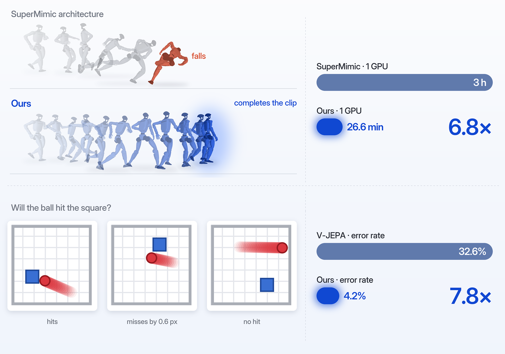

# 只换架构，世界模型还能强多少？

Bangzhe Huang, Ziming Liu · 元环智能 / 清华大学人工智能学院 / 复旦大学物理学系

**阅读全文：<https://metacircleai.github.io/just-change-the-architecture/>**

文章源文件是 `article.zh.md`；修改后运行 `python build.py` 重新生成 `index.html`（需要 `pip install markdown`）。页面字体为 [Inter](https://rsms.me/inter/)（SIL Open Font License，见 `assets/fonts/LICENSE-Inter.txt`）。
