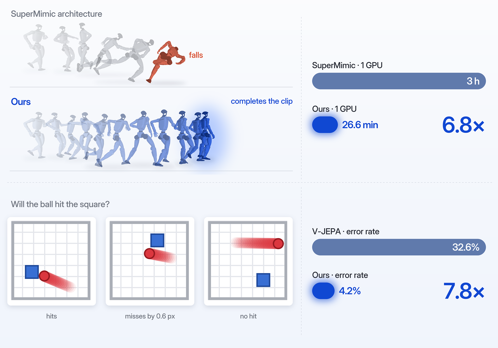
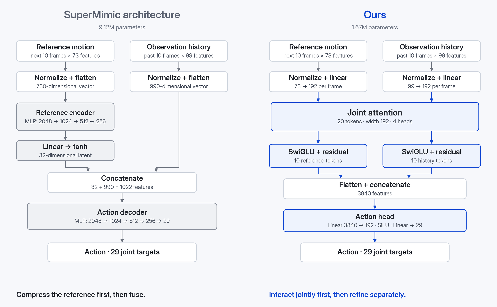
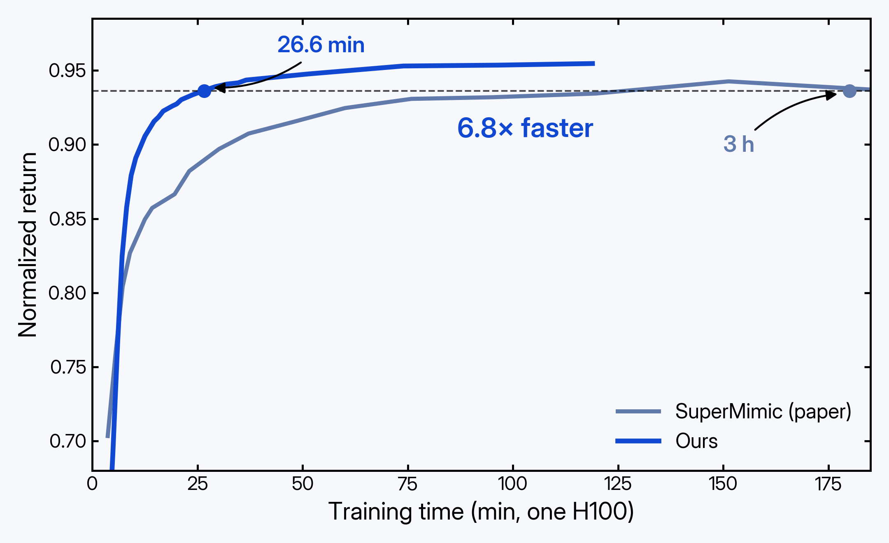
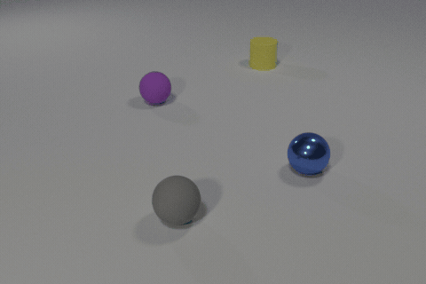
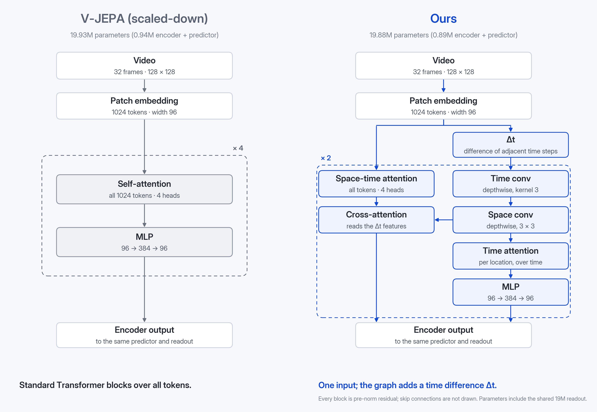
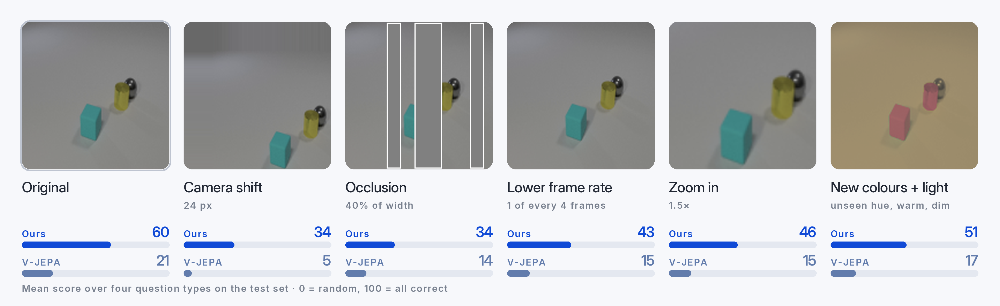

# 只换架构，世界模型还能强多少？

Bangzhe Huang¹ ³, Ziming Liu¹ ²

¹ 元环智能　² 清华大学人工智能学院　³ 复旦大学物理学系

SuperMimic 借助可微世界模型训练人形机器人，把 SONIC 需要 128 张 GPU 跑 7 天的训练，缩短到 1 张 GPU 跑 3 小时。我们重新设计了它的策略网络架构，结合一定的工程优化，又把这 3 小时缩短到了 **26.6 分钟**。

V-JEPA 是 Meta 提出的视频世界模型：它通过预测视频中被遮住的部分，从大量无标注视频中学习物理规律。在 3D 物理场景 CLEVRER 上，我们仅更换其编码器的架构，就把碰撞预测的准确率从 **59%** 提升到了 **86%**。

两个结果说明了同一件事：在数据、规模和训练方法之外，世界模型的架构本身还远没有被挖掘充分。

**图 1** 上：SuperMimic 人形机器人动作跟踪。左为同一段动作（奔跑中侧身闪避、转身 270° 后继续跑），原架构中途摔倒，我们的架构完整跑完；右为单张 GPU 上达到 SuperMimic 训练 3 小时水平所需的时间。下：元模型最初搜索架构时使用的 2D 碰撞任务。左为任务示例，模型需要判断小球会不会撞上方块；右为测试集上的错误率。

## 被忽略的一环

过去两年，世界模型进展飞快：V-JEPA 2 从海量视频中学习物理直觉，Genie 能生成可交互的虚拟世界，SuperMimic 用一个可微的世界模型，让人形机器人在单张 GPU 上学会十几万段动作。

推动这些进展的，主要是更多的数据、更大的规模、更好的训练目标和训练方法。相比之下，网络架构本身很少成为主角：SuperMimic 的策略网络是一个多层 MLP，V-JEPA 的编码器是标准的 ViT。架构往往是"够用就行"的默认选择，而不是被认真打磨的对象。

我们想知道：如果只换架构，世界模型还能强多少？

过去一段时间，我们一直在构建一个元模型：给定一个任务，它会为这个任务设计专门的网络架构。下面两个例子里的新架构，都是由它设计的。

## 例一：SuperMimic，人形机器人全身控制

SuperMimic 解决的是动作跟踪问题：给定一段人类动作，让 Unitree G1 人形机器人在物理仿真里把它做出来。它先学习一个可微的世界模型，预测机器人执行某个动作后的下一个状态；策略网络在这个世界模型的"想象"中展开 32 步，再把跟踪误差直接反向传播回策略。凭借这套方法，它用 1 张 H100 训练 3 小时，就超过了 SONIC 用 128 张 GPU 训练 7 天的效果。

### 原架构：先压缩，再决策

策略每一步要看两样东西：接下来 10 帧的参考动作（机器人"应该"怎么动），以及过去 10 帧的本体观测（机器人"实际"在怎么动）。原架构先用一个四层 MLP，把 10 帧参考动作压缩成一个 32 维向量；再把它和展平的历史观测拼接，交给另一个四层 MLP，输出 29 个关节的目标角度。整个策略约 912 万参数。

### 新架构：先联合交互，再分开精炼

我们把 10 帧参考动作和 10 帧历史观测各自变成 10 个 token，每个 token 对应一帧。20 个 token 先一起做一次 joint attention：参考帧和历史帧可以互相查看，但两组各用自己的 Q/K/V 投影，保留各自的身份。随后两组分开，各自经过一层 SwiGLU 精炼。最后把所有 token 展平，经过一个小 MLP 输出动作。

新架构没有 32 维瓶颈，参数却只有 167 万，约为原来的五分之一。

**图 2** 两种策略架构。左：SuperMimic 原架构，参考动作先经 MLP 压缩为 32 维向量，再与展平的历史观测拼接解码。右：我们的架构，参考帧与历史帧各投影为 10 个 token，先做一次 joint attention，再各自经过 SwiGLU，最后由动作头输出 29 个关节目标。

### 结果

我们让两个架构使用完全相同的训练配方，各训练 45 分钟后评测（表 1）。评测指标是 return，它衡量机器人把动作跟踪得有多准，满分为 1。

**表 1** 同一训练配方下两种策略架构的对比。学习率 8e-4、EMA 0.98，单张 A100 训练 45 分钟，在 1 万段分层抽样的动作上评测；return 满分为 1。

| 策略架构 | 平均 return | 参数量 |
|:---|---:|---:|
| SuperMimic 原架构 | 0.897 | 9.12M |
| 我们的架构 | **0.938** | **1.67M** |

同样 45 分钟，原架构因为单步更快，多训练了 1000 多步，return 却仍然明显更低。

在这套配方上再做一些工程优化，新架构在单张 H100 上只需 26.6 分钟，return 就达到了 SuperMimic 训练 3 小时的水平（图 3）。图 1 左边是一个具体例子：在"奔跑中侧身闪避、转身 270° 后继续跑"这段动作上，原架构中途摔倒，新架构完整跑完。

**图 3** 单张 H100 上 return 随训练时间的变化。灰线取自 SuperMimic 论文；蓝线为我们的架构，每个点是一次全库评测（129,487 段动作），训练时间不含评测。虚线为目标 return 0.9363。

### 为什么有效

原架构隐含了一个要求：策略在看到机器人当前状态之前，就要先把未来 10 帧动作概括成一个 32 维向量。可是未来动作里哪些信息重要，恰恰取决于机器人此刻的状态。直觉上，快要失去平衡时，最该关注的是接下来一两帧怎么落脚；姿态稳定时，则可以看得更远。

新架构把这个顺序倒了过来：先让历史帧和参考帧直接交互，每一帧历史观测都能找到与它相关的未来帧，然后两组再各自精炼。信息的取舍发生在"看过对方之后"，而不是之前。

## 例二：V-JEPA，从视频里预测碰撞

第二个例子来自视频世界模型。我们用的是 CLEVRER，一个常用的 3D 物理推理数据集：桌面上有多个形状、颜色和材质各不相同的物体，它们在运动中相互碰撞，画面里还有阴影、反光和遮挡（图 4）。模型看 32 帧视频，要预测接下来 16 帧里会发生什么。

**图 4** CLEVRER 中的一段视频：多个物体在桌面上运动，并相互碰撞。

训练沿用 V-JEPA 的思路，分两步。先在 8000 段 CLEVRER 视频上做自监督预训练：遮住一部分画面，让模型在表征空间里预测被遮住的内容，不使用任何标签。预训练结束后冻结整个模型，只在它的输出上训练一个读出网络来回答问题。两个模型的读出网络、训练数据和训练轮数完全相同，所以答得好不好，只取决于预训练有没有从视频里学到物理规律。

### 原架构：标准的 Transformer

基线是一个缩小版的 V-JEPA：视频缩放到 128×128，切成时空 patch，每个 patch 变成一个 token，再经过 4 层标准 Transformer。所有 token 在同一个序列里做自注意力，物体的位置、运动和相互关系，都要靠注意力自己去学。

### 新架构：计算图里多了一个时间差分

新架构的输入和基线完全相同，都是同一份 patch token。不同在于 token 进入网络之后怎么被处理（图 5）。编码器由一个小的计算图重复两次组成，图里用的都是常见的算子：

- 时间差分 Δt：相邻两个时刻的 token 相减；之后依次是沿时间方向的卷积、沿空间方向的卷积、只沿时间轴的自注意力和一个 MLP。
- 时空自注意力：在所有时空 token 上做自注意力，再用一次 cross-attention 读取 Δt 之后那几个节点的特征。

两部分的输出合并后，接与基线相同的预测器和读出网络。

**图 5** 两种视频编码器。左：缩小版 V-JEPA，patch token 依次经过 4 个标准 Transformer block，每个为自注意力加 MLP。右：我们的架构，同一个计算图重复两次：Δt（相邻时刻 token 之差）之后接时间卷积、空间卷积、时间轴自注意力和 MLP；时空自注意力之后接 cross-attention，读取 Δt 之后的特征。两者之后接相同的预测器和读出网络。参数量包含读出网络。

### 结果

两个模型使用相同的数据划分、预训练轮数和读出网络，总参数量也相当。只有一处不同：基线加了学习率 warmup，因为不加时它的表征会在训练早期塌缩；我们的架构不需要。读出网络按验证集选定后，只在 1000 段从未见过的测试视频上评测一次（表 2）。

**表 2** CLEVRER 上的碰撞预测：接下来 16 帧里会不会发生碰撞。测试集共 1000 段视频；准确率为会撞与不会撞两类准确率的平均，随机为 50%；AUC 随机为 50，满分为 100。参数量为预训练模型（编码器和预测器）与读出网络之和，两者的读出网络完全相同。

| 编码器架构 | 准确率 | AUC | 参数量 |
|:---|---:|---:|---:|
| V-JEPA（缩小版） | 59.0% | 67.0 | 19.9M |
| 我们的架构 | **85.7%** | **93.4** | 19.9M |

参数量相当，准确率高出约 27 个百分点。

### 更多问题，更难的测试

只判断"会不会撞"还不够。我们又让两个模型回答另外三类问题：会撞几次、第一次碰撞在什么时候、碰撞发生在桌面的哪个区域。随后在测试视频上加入训练时从没见过的干扰：画面平移、部分遮挡、降低帧率、镜头放大，以及换成新的颜色和光照（图 6）。题目和答案都不变，变的只是画面。

**图 6** 同一段测试视频在五类干扰下的样子（各取最强一档，与模型实际看到的画面一致，遮挡位置用白框标出），以及两个模型在每类干扰下四类问题的平均得分。

**表 3** 四类问题的平均得分，0 为随机，100 为全对。"加入干扰"为五类干扰各取最强一档后的平均；"全部答对"要求同一段视频的所有问题都答对，同样换算成 0 为随机。

| | V-JEPA（缩小版） | 我们的架构 |
|:---|---:|---:|
| 四类问题平均，原始视频 | 21.1 | **60.3** |
| 四类问题平均，加入干扰 | 13.3 | **41.8** |
| 全部答对，原始视频 | 13.1 | **51.8** |
| 全部答对，加入干扰 | 6.1 | **35.6** |

加入干扰后，基线"全部答对"的得分几乎跌回随机水平；我们的架构仍保留了约七成。

### 为什么有效

两个模型看到的信息完全一样：同一段视频、同一份 patch token。新架构没有引入任何额外的输入，区别只在于这些信息被怎样处理。

判断会不会碰撞，关键在于物体怎么运动：往哪个方向走、走多快、会不会和别的物体相遇。这些信息本来就藏在相邻帧的差别里。原架构理论上也能把它算出来，但需要注意力在大量几乎一样的 token 中自己学会"比较相邻两帧"，学起来又慢又难。

新架构把这一步直接写进了计算图：先比较相邻两帧，再用局部卷积和沿时间轴的注意力，把这些变化整理成连贯的运动；时空自注意力处理整体关系，并通过 cross-attention 读取整理好的运动信息。信息还是那些信息，只是被组织成了更适合回答物理问题的形式。基线则不同：它知道物体在哪里（"碰在哪个区域"一题它也答得不错），却很难预测物体会怎么动。

### 这个架构从哪里来

这个架构并不是在 CLEVRER 上设计的。元模型最初在一个更简单的 2D 世界里搜索架构：画面里一个红球匀速运动，判断它会不会撞上静止的方块。在那里，新架构把准确率从 67.4% 提高到了 95.8%。搬到 CLEVRER 时，我们没有改动它的结构，只是把输入换成 128×128 的视频、在新数据上从头训练。一个在简单世界里找到的结构，在复杂得多的 3D 场景里依然成立。

## 小结

两个例子来自完全不同的世界模型：一个在物理仿真里控制人形机器人，一个从视频里学习物理规律。在这两个任务上，我们都没有改变输入、数据或训练目标，只是换了一个架构，结果就有了大幅提升：SuperMimic 在同样 45 分钟的训练下，return 从 0.897 提高到 0.938，再加上工程优化，达到原训练 3 小时水平只需 26.6 分钟；3D 场景里的碰撞预测准确率从 59% 提升到 86%。

两个新架构也有相似之处。原架构都采用了"一刀切"的处理方式：SuperMimic 先把参考动作压缩成一个小向量，再和其他信息拼在一起；V-JEPA 把所有 token 放进同一种 block 里统一处理。新架构则让不同的信息先按各自的特点处理，再在合适的位置交互。这些设计都不复杂，用到的也都是常见的组件，却没有出现在原本的架构里。

这正是我们想说明的：除了数据、规模和训练方法，世界模型的架构设计同样有着很大的提升空间。

## 写在最后

这两个例子只是开始。我们正在把元模型用到更多的领域上，包括时间序列、AI for science、世界模型等等。后续结果会陆续分享。

如果你也对架构设计感兴趣，或者手上有想让元模型试一试的任务，欢迎和我们交流。

